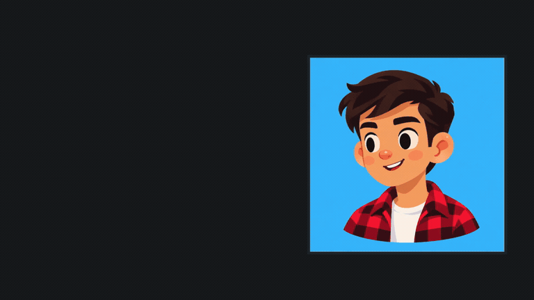
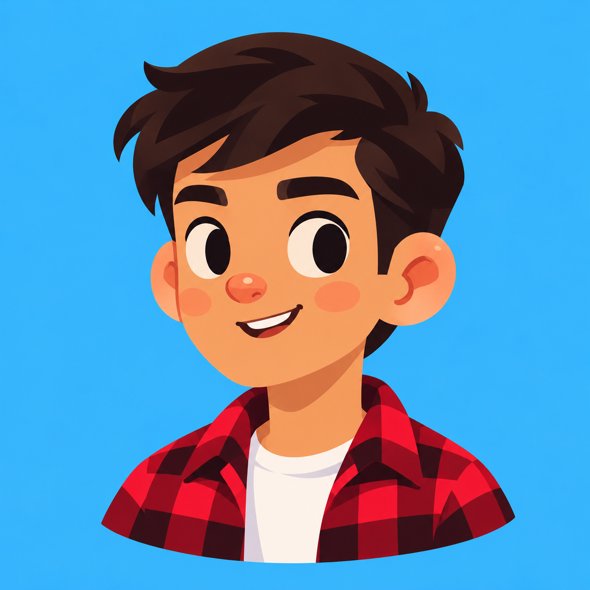

# Avatar Motion

**Your face, this illustration style, alive to the cursor.**

An installable agent skill for cursor-responsive portfolio avatars: eye tracking, head movement, pinned hair tips, breathing, click expressions and local **Framer / HTML exports**.

Give your coding agent a photo. It uses the bundled visual reference to create your avatar in this specific warm cartoon style, fits an image-specific rig, and adds cursor interaction with the bundled renderer.

## See it move

[](https://github.com/dedkul/avatar-motion/raw/refs/heads/main/docs/demo.mp4)

[Download the full 20-second video with sound — 1080p, 60 fps](https://github.com/dedkul/avatar-motion/raw/refs/heads/main/docs/demo.mp4).

The inline preview is an animated GIF for GitHub README compatibility. The linked MP4 preserves the full video quality. Recorded from the original fitted avatar prototype; it demonstrates the intended result rather than an automatic transformation of an unseen photo. [Media credits](docs/media-credits.txt).

## One illustration style, your identity



**This is the visual target for the skill.** Rounded facial forms, a small coral-red nose, subtly rosy cheeks, slightly enlarged ears, large ivory oval eyes, single-shade eyebrows and sculpted hair shapes, finished like a polished 2D Illustrator illustration with controlled warm shading.

Your facial structure, natural skin tone, hair texture and hairstyle, facial hair, clothing and pose can vary. The rendering style stays consistent. The example's identity, red shirt and blue background are not a template to copy onto everyone.

The installed skill includes this image and [art-direction guidance](skills/avatar-motion/references/art-direction.md). It requires the agent to inspect the reference, use it as an image-generation style input, and check the result against it before animation. A generic geometric face, extremely low-poly icon, 3D avatar or paper-cutout treatment is not an acceptable substitute.

> **Experimental v0.1.1.** This is an agent-assisted illustration and fitting workflow, not a one-click face detector or a trained style model. Illustration generation needs an image tool that accepts visual references. The reference and review steps aim for style consistency; identical results across models are not guaranteed. Start with front-facing or slightly turned busts with visible eye whites and dark pupils.

The approved illustration and demo video are shared with the creator's permission. Input photos, guidebooks and credentials are not included.

## Install

### Codex

```sh
codex plugin marketplace add dedkul/avatar-motion
codex plugin add avatar-motion@avatar-motion
```

### Claude Code

```text
/plugin marketplace add dedkul/avatar-motion
/plugin install avatar-motion@avatar-motion
```

### Other coding agents

Install the skill with the [skills CLI](https://github.com/vercel-labs/skills):

```sh
npx skills add https://github.com/dedkul/avatar-motion --skill avatar-motion
```

Use `-g` for a global installation if that suits your setup. Or copy the complete `skills/avatar-motion/` directory to your agent's supported skills directory. The repo also exposes an internal `.agents/skills/` discovery symlink; installers that copy the skill directly do not need symlink support.

Start a new agent conversation after installing if the skill is not yet discovered.

## Use it

Attach a clear face photo or an illustration and ask:

> Use avatar-motion to turn my photo into an avatar in its bundled reference style: warm rounded cartoon shapes, a coral nose, slightly enlarged ears and expressive oval eyes. Preserve my likeness, skin tone and hairstyle. Add cursor-following eyes, subtle head movement, breathing and isolated hair-tip motion, then export a Framer component and standalone HTML.

For existing art in this style:

> Animate this illustration with avatar-motion. Keep the drawing intact. Fit the eyes and hair tips, show me the preview, and let me adjust the intensity.

The agent needs image inspection and file/shell access. Generating an illustration from a photo also needs an image-generation tool that accepts the bundled style image alongside the identity photo. There is no image API key or hosted generation service bundled with this repo. If the required image tools are unavailable, the skill asks for a matching illustration instead of producing a simplified substitute.

## Try the included demo

Requires **Node.js 22.18+**. Building exports uses Node built-ins; no npm install is needed.

```sh
git clone https://github.com/dedkul/avatar-motion.git
cd avatar-motion
npm run demo
npm run preview
```

Open `http://127.0.0.1:8812/preview.html`. The runnable demo uses the approved illustration above, with its own fitted rig. Move the cursor, click the character, try Slow blink and adjust the sliders. Use the preview's export buttons to save your chosen defaults. These coordinates apply only to this portrait; every new face needs fitting.

For your own fitted illustration:

```sh
node skills/avatar-motion/scripts/build.mjs \
  --image portrait.png --rig rig.json --out avatar-output
node skills/avatar-motion/scripts/serve.mjs avatar-output 8812
```

Choose a fresh output directory. `--force` can update a previously generated Avatar Motion output; it refuses unrelated directories. Use `--settings settings.json` to rebuild with saved motion defaults and `--validate rig.json` to check a rig without exporting.

## What you get

| File               | Purpose                                                         |
| ------------------ | --------------------------------------------------------------- |
| `preview.html`     | Local motion tuner, source comparison and blink/gaze inspection |
| `avatar.html`      | Self-contained interactive HTML with the portrait embedded      |
| `AvatarMotion.tsx` | Framer Code Component with movement property controls           |
| `rig.json`         | Fitted coordinates, samples and feature masks                   |
| `settings.json`    | Reproducible movement defaults                                  |

The browser renderer has no animation-library or CDN dependency. It uses the supplied artwork as a WebGL texture, with separate pupil movement and eyelid occlusion, connected head/neck motion, local tip bending and torso expansion. It preserves aspect ratio in non-square frames, supports reduced motion, suspends GPU animation offscreen and provides a source-image fallback.

In Framer, paste `AvatarMotion.tsx` into a new Code Component, insert it and test in **Preview**. The editing canvas shows a neutral pose. A Code Component can follow the pointer across the page; HTML in an iframe only sees its own document. [Framer setup details](skills/avatar-motion/references/framer.md).

## Fitting matters

A generated portrait does **not** inherit a correct rig automatically. The agent must measure its geometry and review the actual preview. [Rig format and fitting notes](skills/avatar-motion/references/rig-format.md) explain the schema and the example.

- Start with open, unobstructed eyes and simple dark pupils; glasses, occlusion and painted eyes need extra work.
- Hair tips need distinct roots and narrow influence regions. Do not wave the entire hair mass.
- Optional brows and mouth reactions should be omitted when they cannot be fitted cleanly.
- Eyelid skin/white samples are image-specific; wrong samples produce visible patches.
- Inspect at your intended header size and on your target devices.
- These are texture-based exports, not `.riv` files or native animated SVG rigs. If your source is SVG, keep that editable original separately.
- Browser tests and TypeScript checks do not establish compatibility with every browser/GPU or successful insertion into an actual Framer project.

## Contribute

```sh
npm ci
npm test
npm run typecheck
```

Tests cover rig validation, safe export handling, overwrite protection and generated component types. The simple SVG in `tests/fixtures/` tests geometry and export mechanics only; it is excluded from the installed skill and is not an illustration-quality example. Visual fitting still needs browser review. The implementation and approved style reference live inside the installable skill so they travel together.

MIT licensed. Not affiliated with Framer, Rive, OpenAI or Anthropic. Created from a portfolio-avatar experiment; packaged as a reusable workflow rather than a promise of perfect one-shot generation.
